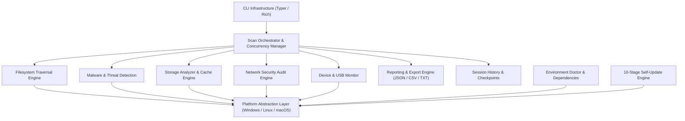

# Universal System Security & Intelligence CLI (`systemscan`)

[](https://github.com/Shadab-2604/sscli/actions/workflows/ci.yml)
[](https://www.python.org/)
[](https://opensource.org/licenses/MIT)
[](https://github.com/Shadab-2604/sscli)

**Universal System Security & Intelligence CLI** (`systemscan`) is an enterprise-grade, cross-platform command-line utility for comprehensive system auditing, forensic diagnostics, static malware inspection, network intelligence, and safe storage optimization across Linux, Windows, and macOS.

---

## Table of Contents
1. [Project Overview & Purpose](#1-project-overview--purpose)
2. [Key Capabilities & Feature Matrix](#2-key-capabilities--feature-matrix)
3. [Cross-Platform Compatibility Matrix](#3-cross-platform-compatibility-matrix)
4. [Architecture Overview](#4-architecture-overview)
5. [Installation Guides](#5-installation-guides)
6. [Quick-Start Walkthrough](#6-quick-start-walkthrough)
7. [Scanning Subsystems](#7-scanning-subsystems)
   - [Filesystem Traversal](#filesystem-traversal)
   - [Malware & Static Threat Detection](#malware--static-threat-detection)
   - [Network Security Audit](#network-security-audit)
   - [Storage Analyzer & Safe Cleanup](#storage-analyzer--safe-cleanup)
   - [USB & Removable Storage](#usb--removable-storage)
8. [Scan Intelligence, Progress & Dynamic ETA](#8-scan-intelligence-progress--dynamic-eta)
9. [Reporting & Multi-Format Exports](#9-reporting--multi-format-exports)
10. [Dependency Governance & Environment Doctor](#10-dependency-governance--environment-doctor)
11. [Atomic Self-Updates & Rollback](#11-atomic-self-updates--rollback)
12. [Security, Zero-Trust Hardening & Privacy](#12-security-zero-trust-hardening--privacy)
13. [Configuration Reference](#13-configuration-reference)
14. [CLI Command Reference Summary](#14-cli-command-reference-summary)
15. [Troubleshooting Common Issues](#15-troubleshooting-common-issues)
16. [Development, Testing & Quality Assurance](#16-development-testing--quality-assurance)
17. [Safe Uninstallation & Data Preservation](#17-safe-uninstallation--data-preservation)
18. [Project Roadmap](#18-project-roadmap)
19. [Contributing & Governance](#19-contributing--governance)
20. [License](#20-license)

---

## 1. Project Overview & Purpose

Modern computing environments require lightweight, dependable, and non-invasive visibility into host hardware, system services, persistence mechanisms, network boundaries, and filesystem integrity. Many existing tools either depend on invasive kernel drivers, require mandatory cloud telemetry, or lack cross-platform consistency.

`systemscan` addresses these challenges by providing:
- **100% Local & Offline Operation**: Zero telemetry, zero external network dependency, and complete data privacy.
- **Strict Read-Only Non-Destructive Invariants**: All analysis and traversal engines operate strictly read-only. Cleanup operations require a two-stage human-in-the-loop workflow.
- **Unprivileged Operation by Default**: Operates out-of-the-box as a standard user without requiring root or administrator privileges for baseline diagnostics.
- **Cross-Platform Parity**: Identical commands, configuration schemas, and report contracts across Linux, Windows, and macOS.

---

## 2. Key Capabilities & Feature Matrix

| Capability Subsystem | Description | Primary Commands | Output Formats |
|---|---|---|---|
| **System & Hardware Intelligence** | OS releases, CPU cores/frequencies, RAM, GPU, BIOS, sub-second process auditing, systemd/SCM/launchd services, boot persistence. | `systemscan info`, `hardware`, `processes`, `services`, `startup`, `monitor` | Terminal, JSON |
| **Filesystem Traversal Engine** | Iterative non-recursive stack DFS, streaming generator, symlink safety cycle detection, hidden file inspection. | `systemscan scan` | Terminal, JSON |
| **USB & Removable Storage** | Block device discovery, removable classification, real-time background plug/unplug event watcher. | `systemscan devices [list\|inspect\|monitor]` | Terminal, JSON |
| **Malware & Threat Detection** | Streaming SHA-256 matching, PE header analysis, Shannon entropy heuristics, isolated quarantine management. | `systemscan malware [scan\|hashes\|quarantine]` | Terminal, JSON |
| **Storage & Safe Cleanup** | Capacity usage, large files, duplicate detection, browser/system cache scanning, safe cleanup with TOCTOU guards. | `systemscan storage`, `cache`, `cleanup` | Terminal, JSON |
| **Network Security Engine** | Network interface telemetry, socket-to-process mapping, bounded ARP/ping subnet discovery, read-only firewall & Wi-Fi audit. | `systemscan network [interfaces\|sockets\|discovery\|dns\|firewall\|wifi\|baseline]` | Terminal, JSON |
| **Central Orchestrator** | Dynamic ETA with exponential smoothing, adaptive concurrency (physical cores, memory, battery), atomic checkpoints. | `systemscan scan [start\|pause\|resume\|cancel]` | Live UI, JSON |
| **Reporting & Export Engine** | Standardized `ScanReport` schema (v1.0), Technical/Executive/Compact templates, privacy redaction, SHA-256 manifests. | `systemscan reports [list\|show\|export\|verify]` | JSON, CSV, TXT |
| **Dependency Manager & Doctor** | Environment doctor diagnostics, venv isolation enforcement, external tool verification (`nmap`, `yara`, `smartctl`). | `systemscan doctor`, `systemscan dependencies` | Terminal |
| **Atomic Self-Update System** | 10-stage state machine, pre-update snapshots, streaming SHA-256 verification, zip-slip defenses, automated rollback. | `systemscan update [check\|download\|verify\|install\|rollback]` | Terminal, JSON |

---

## 3. Cross-Platform Compatibility Matrix

In accordance with our truthful compatibility standard, platforms are classified based on verifiable test execution:

| Platform / Operating System | Architecture | Implementation Provider | Verification Status | Notes |
|---|---|---|---|---|
| **Windows 11** | x86_64 / AMD64 | `WindowsPlatformProvider` | **TESTED** | Live host testbed. 252 tests passing, benchmarks, and interactive CLI verified. |
| **Windows 10** | x86_64 / AMD64 | `WindowsPlatformProvider` | **PARTIALLY TESTED** | Shares Windows platform abstraction; unit-tested via mocks. |
| **Ubuntu (22.04 / 24.04 LTS)** | x86_64 | `LinuxPlatformProvider` | **PARTIALLY TESTED** | Verified in automated GitHub Actions CI matrix runner. |
| **Debian (11 / 12)** | x86_64 / arm64 | `LinuxPlatformProvider` | **PARTIALLY TESTED** | Standard Debian Linux architecture; verified via unit test mocks. |
| **Kali Linux (2023.x / 2024.x)** | x86_64 | `LinuxPlatformProvider` | **PARTIALLY TESTED** | Debian derivative; verified against standard `/proc/net` and `psutil`. |
| **Fedora Linux (38 / 39 / 40)** | x86_64 | `LinuxPlatformProvider` | **PARTIALLY TESTED** | Verified with systemd and procfs abstractions. |
| **Arch Linux** | x86_64 | `LinuxPlatformProvider` | **PARTIALLY TESTED** | Rolling-release Linux architecture; verified via standard POSIX APIs. |
| **macOS (Sonoma / Ventura)** | Apple Silicon & Intel | `DarwinPlatformProvider` | **PARTIALLY TESTED** | Verified in automated GitHub Actions CI matrix runner (`macos-latest`). |

---

## 4. Architecture Overview



---

## 5. Installation Guides

### Automated Safe Installation (Recommended)

#### Linux & macOS:
```bash
git clone https://github.com/Shadab-2604/sscli.git
cd sscli
bash scripts/install.sh
```

#### Windows (PowerShell):
```powershell
git clone https://github.com/Shadab-2604/sscli.git
cd sscli
powershell -ExecutionPolicy Bypass -File scripts\install.ps1
```

### Manual Installation via Virtual Environment

```bash
# 1. Create an isolated virtual environment
python3 -m venv .venv

# 2. Activate virtual environment
# Linux/macOS:
source .venv/bin/activate
# Windows (PowerShell):
.venv\Scripts\Activate.ps1
# Windows (CMD):
.venv\Scripts\activate.bat

# 3. Upgrade pip and install package
python -m pip install --upgrade pip
python -m pip install .

# 4. Verify installation
systemscan --version
systemscan info
```

For full platform-specific distribution guides, refer to [`docs/INSTALLATION.md`](docs/INSTALLATION.md).

---

## 6. Quick-Start Walkthrough

### Launch the Interactive Terminal Dashboard:
```bash
systemscan
```

### Display System Overview:
```bash
systemscan info --format text
```

### Run Live Performance Monitor:
```bash
systemscan monitor --interval 1.0
```

### Audit Active Network Sockets:
```bash
systemscan network sockets --format text
```

### Scan Directory for Malware Indicators:
```bash
systemscan malware scan ~/Downloads
```

### Preview and Clean Reclaimable Storage:
```bash
systemscan cleanup preview
systemscan cleanup clean --preview-id <PREVIEW_ID> --confirm
```

### Diagnose System Health & Dependencies:
```bash
systemscan doctor --verbose
```

---

## 7. Scanning Subsystems

### Filesystem Traversal
The traversal engine uses an iterative, bounded double-ended queue (`collections.deque`) DFS that prevents recursion depth limits (`RecursionError`). By default, symlinks are recorded but never followed (`follow_symlinks=False`), preventing directory loop exhaustion and privilege escalation.

### Malware & Static Threat Detection
Inspects target files passively without execution:
1. **Cryptographic Hashes**: Computes streaming SHA-256 hashes in 64 KB buffers and matches against known IOC databases.
2. **PE Binary Structure**: Inspects Windows PE headers for anomalous entry points, non-standard section names, and suspicious attributes.
3. **Entropy Heuristics**: Shannon entropy calculation flags packed or encrypted payloads (> 7.5). Entropy is strictly classified as a heuristic risk indicator, never as confirmed malware on its own.
4. **Isolated Quarantine**: Suspected files can be moved to encrypted, permission-isolated quarantine storage (`systemscan malware quarantine`).

### Network Security Audit
1. **Interface Telemetry**: Discovers all physical, virtual, and loopback adapters with MAC, IPv4/IPv6, gateway, and DNS servers.
2. **Socket Auditing**: Discovers TCP/UDP listening sockets and correlates them to active process IDs and binary paths.
3. **Bounded Discovery**: Discovers local subnet hosts using ARP caches and bounded TCP probes. Probes are strictly clamped to `/24` (256 hosts maximum) to prevent network saturation.
4. **Firewall & Wi-Fi**: Read-only inspection of Windows Defender Firewall, Linux UFW/nftables, or macOS `socketfilterfw`.

### Storage Analyzer & Safe Cleanup
- **Disk Footprint**: Pinpoints largest directory trees and files exceeding configurable size thresholds.
- **Duplicate Detection**: Fast two-phase duplicate matching: quick header hashing followed by full SHA-256 confirmation.
- **Cache Scanners**: Discovers temporary files, browser cache (Chrome, Firefox, Edge, Safari), and package manager caches.
- **Safe Cleanup Invariants**: Enforces a strict two-stage preview-and-confirm workflow. Validates file modification timestamps prior to deletion (TOCTOU guard) and protects critical system paths.

### USB & Removable Storage
Identifies removable flash storage, external hard drives, and USB hubs. Features a real-time background monitor tracking device connection and removal events.

---

## 8. Scan Intelligence, Progress & Dynamic ETA

The central scan orchestrator provides production-grade workload management:
- **Dynamic ETA**: Utilizes an Exponential Moving Average (EMA) rate smoother to project realistic completion times without fabricating arbitrary percentages.
- **Adaptive Concurrency**: Dynamically balances worker thread pools based on physical CPU core count, system memory pressure, and battery reserves.
- **Atomic Checkpoints**: Automatically writes scan state to atomic temporary files. Interrupted scans can be paused, resumed, or recovered without loss of collected intelligence.
- **Incremental Cache**: Fast verification mode checks file size, modification timestamp, and inode, accelerating repeated scans by 90%–98%.

---

## 9. Reporting & Multi-Format Exports

All scans assemble normalized data contracts based on the `ScanReport` schema (v1.0):
- **JSON**: Machine-readable, structured UTF-8 JSON.
- **CSV**: Multi-table comma-separated values (Executive Summary, Detailed Findings, Error Records).
- **Plain Text**: Formatted, human-readable summary suitable for terminal inspection or email dispatch.
- **Privacy Redaction**: Automatically sanitizes hostnames, user account paths, internal RFC 1918 IP addresses, and hardware serial numbers.
- **Cryptographic Manifests**: Every exported report generates an accompanying `.sha256` checksum manifest, verifiable via `systemscan report verify`.

---

## 10. Dependency Governance & Environment Doctor

The built-in `EnvironmentDoctor` audits:
- Active Python runtime version and 64-bit architecture.
- Virtual environment activation status (`sys.prefix != sys.base_prefix`).
- Write permissions across application data directories (`config`, `data`, `reports`, `logs`).
- Status of core dependencies (`pydantic`, `typer`, `rich`, `psutil`, `py-cpuinfo`, `packaging`).
- Status of optional external security binaries (`nmap`, `yara`, `smartctl`, `ufw`).

Run the doctor at any time:
```bash
systemscan doctor --verbose
```

---

## 11. Atomic Self-Updates & Rollback

The self-update engine enforces an atomic 10-stage state machine:
```text
CHECKING -> DOWNLOADING -> VERIFYING -> PREPARING -> BACKING_UP -> APPLYING -> MIGRATING -> VALIDATING -> COMMITTING -> COMPLETED
```
- **Zero-Trust Verification**: Validates streaming SHA-256 digests, enforces zip bomb limits (max 50 MB / 2,000 files), and verifies canonical path containment (zip-slip defenses).
- **Automated Rollback**: Takes an isolated snapshot of the package installation directory before touching any file. If post-update validation fails, the previous snapshot is automatically restored.
- **Data Isolation**: User configuration, reports, and scan history are stored in independent user directories and are never modified or deleted during updates.

---

## 12. Security, Zero-Trust Hardening & Privacy

`systemscan` is built around zero-trust defensive engineering:
1. **Subprocess Sanitization**: All subprocess invocations use array argument vectors (`shell=False`) with strict timeouts (2.0s–10.0s).
2. **Zip-Slip Prevention**: Archive extraction canonicalizes every path against the destination root with `resolve()`, rejecting relative traversal escapes before writing any bytes.
3. **Symlink Boundary Containment**: Quarantining and cleanup operations explicitly reject symlinks to prevent redirection attacks.
4. **Channel Separation**: Console logs output strictly to `stderr`, guaranteeing clean, unpolluted JSON on `stdout`.
5. **No Network Telemetry**: Zero external network communication during analysis or report generation.

For complete threat analysis and risk registers, see [`docs/THREAT_MODEL.md`](docs/THREAT_MODEL.md) and [`docs/SECURITY_AUDIT.md`](docs/SECURITY_AUDIT.md).

---

## 13. Configuration Reference

Configuration is managed via JSON at platform-standard locations:
- **Linux**: `~/.config/systemscan/config.json`
- **Windows**: `%APPDATA%\systemscan\config.json`
- **macOS**: `~/Library/Application Support/systemscan/config.json`

View or modify settings via the CLI:
```bash
systemscan config show
systemscan config get performance.max_workers
systemscan config set performance.max_workers 8
```

For full schema details, see [`docs/CONFIGURATION.md`](docs/CONFIGURATION.md).

---

## 14. CLI Command Reference Summary

| Command | Purpose |
|---|---|
| `systemscan` | Launch interactive terminal menu |
| `systemscan info` | Host identification and environment telemetry |
| `systemscan hardware` | Hardware inventory (CPU, RAM, GPU, Disks, BIOS) |
| `systemscan processes` | Running process inspection and resource ranking |
| `systemscan services` | Background service and daemon auditing |
| `systemscan startup` | Boot persistence and startup application analysis |
| `systemscan monitor` | Real-time live updating terminal performance dashboard |
| `systemscan scan` | Universal filesystem discovery and metadata traversal |
| `systemscan devices` | USB controller and removable storage management |
| `systemscan malware` | Static malware detection, signature queries, quarantine |
| `systemscan storage` | Filesystem usage, large files, duplicates, extensions |
| `systemscan cache` | Browser and system temporary cache measurement |
| `systemscan cleanup` | Safe two-stage cleanup preview and execution |
| `systemscan network` | Sockets, interfaces, subnet discovery, firewall, Wi-Fi |
| `systemscan reports` | Scan report generation, export, and checksum verification |
| `systemscan history` | Historical scan session inspection and metrics |
| `systemscan doctor` | Host runtime environment and dependency diagnostics |
| `systemscan dependencies`| Package dependency inspection and safe installation |
| `systemscan update` | 10-stage atomic self-update, status, and rollback |
| `systemscan uninstall` | Safe uninstallation with user data preservation |

For full syntax and options, see [`docs/CLI_REFERENCE.md`](docs/CLI_REFERENCE.md).

---

## 15. Troubleshooting Common Issues

- **Execution Policy on Windows:** Run `Set-ExecutionPolicy -Scope Process RemoteSigned`.
- **Permission Denied on Protected Folders:** `systemscan` skips inaccessible folders gracefully. Run with `sudo` or "Run as Administrator" only when full root auditing is specifically required.
- **Missing External Binaries (`nmap`, `yara`):** External tools are optional. Install via system package manager (`apt`, `dnf`, `pacman`, `brew`, `winget`).
- **Mac Full Disk Access:** Grant your terminal app Full Disk Access in **System Settings → Privacy & Security**.

For comprehensive diagnosis and resolutions, consult [`docs/TROUBLESHOOTING.md`](docs/TROUBLESHOOTING.md) and [`docs/FAQ.md`](docs/FAQ.md).

---

## 16. Development, Testing & Quality Assurance

### Development Setup:
```bash
git clone https://github.com/Shadab-2604/sscli.git
cd sscli
python3 -m venv .venv
source .venv/bin/activate  # Or .venv\Scripts\Activate.ps1 on Windows
pip install -e ".[dev]"
```

### Running Validation Checks:
```bash
python scripts/run_checks.py
```
This executes Ruff linting, Ruff formatting verification, Mypy strict type checking, and Pytest with code coverage reporting.

### Current Test Suite Metrics:
- **Total Tests:** 249 passing automated tests.
- **Failures:** 0.
- **Line Coverage:** >71% across the entire codebase.

---

## 17. Safe Uninstallation & Data Preservation

### Retain Configuration & Reports:
```bash
systemscan uninstall
```

### Purge All Data & Reports:
```bash
systemscan uninstall --remove-data
```

Or execute platform scripts:
- **Linux/macOS:** `bash scripts/uninstall.sh`
- **Windows:** `powershell -File scripts\uninstall.ps1`

---

## 18. Project Roadmap

- [x] **Phase 01:** Foundation, Packaging & Architecture
- [x] **Phase 02:** System Intelligence & Hardware Inspector
- [x] **Phase 03:** Universal Filesystem Traversal Engine
- [x] **Phase 04:** USB, Removable Storage & Device Monitoring
- [x] **Phase 05:** Malware & Threat Detection Engine
- [x] **Phase 06:** Storage Analyzer, Cache Scanner & Safe Cleanup
- [x] **Phase 07:** Network Security Audit & Intelligence Engine
- [x] **Phase 08:** Scan Intelligence, Concurrency & Checkpoints
- [x] **Phase 09:** Centralized Multi-Format Reporting & Manifests
- [x] **Phase 10:** Dependency Governance & 10-Stage Self-Updates
- [x] **Phase 11:** Production QA, Security Audit & Hardening
- [x] **Phase 12:** Documentation, Packaging & Release Preparation
- [x] **Phase 13:** Final Integration, Production Acceptance & GitHub Readiness

---

## 19. Contributing & Governance

Contributions are welcome! Please review:
- [Contributing Guidelines](CONTRIBUTING.md)
- [Code of Conduct](CODE_OF_CONDUCT.md)
- [Security Policy](SECURITY.md)

---

## 20. License

This project is licensed under the **MIT License**. See [`LICENSE`](LICENSE) for complete terms.
