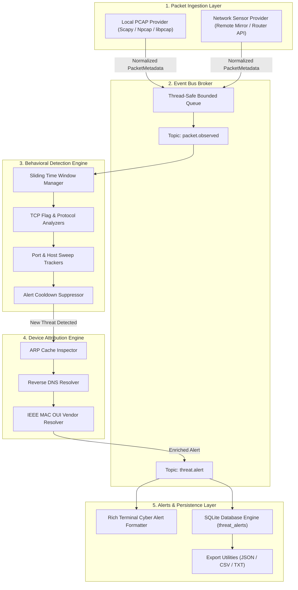

# SSCLI Network Threat Monitor System Architecture

## Architecture Overview

The **Network Threat Monitor** follows an asynchronous event-driven, producer-consumer architecture. It separates packet ingestion, protocol decoding, behavioral correlation, attribution enrichment, and alert dispatching into decoupled modules.

---

## Component Specifications

### 1. Ingestion Layer (`systemscan.network_monitor.capture`)
- **`BaseCaptureProvider`:** Abstract base class defining lifecycle methods (`start_capture()`, `stop_capture()`, `get_health_status()`).
- **`PcapCaptureProvider`:** Wraps Scapy/libpcap/Npcap. Extracts layer 2/3/4 fields and encapsulates into a strongly-typed `PacketMetadata` data class.
- **`NetworkSensorCaptureEngine`:** Manages external sensors, mirrored interfaces, or router APIs. Truthfully degrades to `SensorHealthStatus.UNCONFIGURED` if no remote endpoint is provided.

### 2. Event Bus Broker (`systemscan.network_monitor.event_bus`)
- Decouples capture threads from detection and I/O.
- Implements thread-safe pub/sub with a bounded queue (`maxsize=10000`) to prevent memory exhaustion under high-throughput traffic spikes.

### 3. Behavioral Detection Engine (`systemscan.network_monitor.detection`)
- **`NetworkScanDetectionEngine`:** Maintains per-source sliding time windows.
- Tracks unique destination ports contacted per IP.
- Detects stealth patterns:
  - Null scans (flags `0x00`)
  - FIN scans (only `FIN`)
  - Xmas scans (`FIN + PSH + URG`)
- Suppresses repetitive alert notifications via `_alert_cooldowns` dictionary.

### 4. Device Attribution Engine (`systemscan.network_monitor.identification`)
- **`DeviceIdentificationEngine`:** Resolves hardware identities for IP addresses.
- Correlates IP to MAC using local OS ARP tables (`arp -a` / `/proc/net/arp` / `ip neighbor`).
- Resolves hostnames via local DNS / reverse DNS lookup.
- Maps MAC prefixes to hardware manufacturer vendors using IEEE OUI databases.

### 5. Persistence Layer (`systemscan.network_monitor.storage`)
- **`NetworkAlertDatabase`:** Persists alerts to an SQLite database located in the user's application data directory (`threat_alerts` table).
- Provides filtering, listing, and structured export to JSON, CSV, and formatted text.

